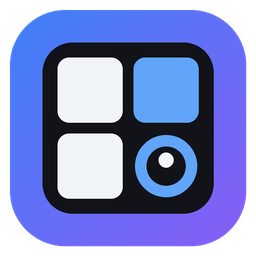
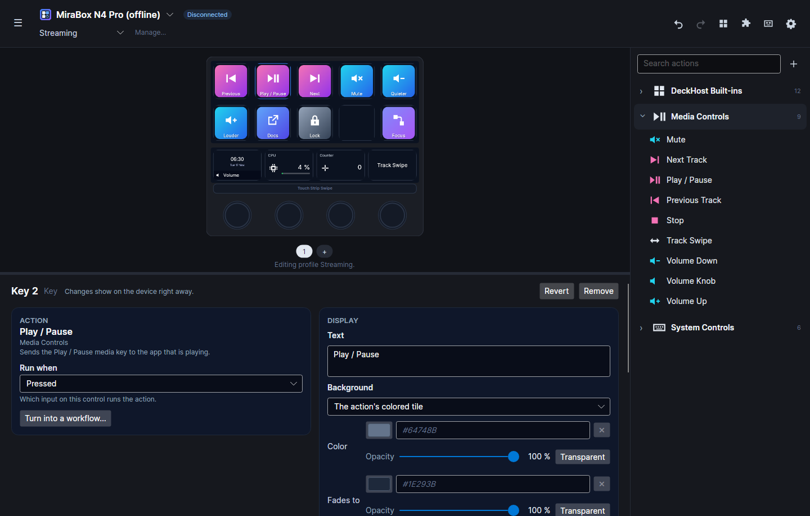
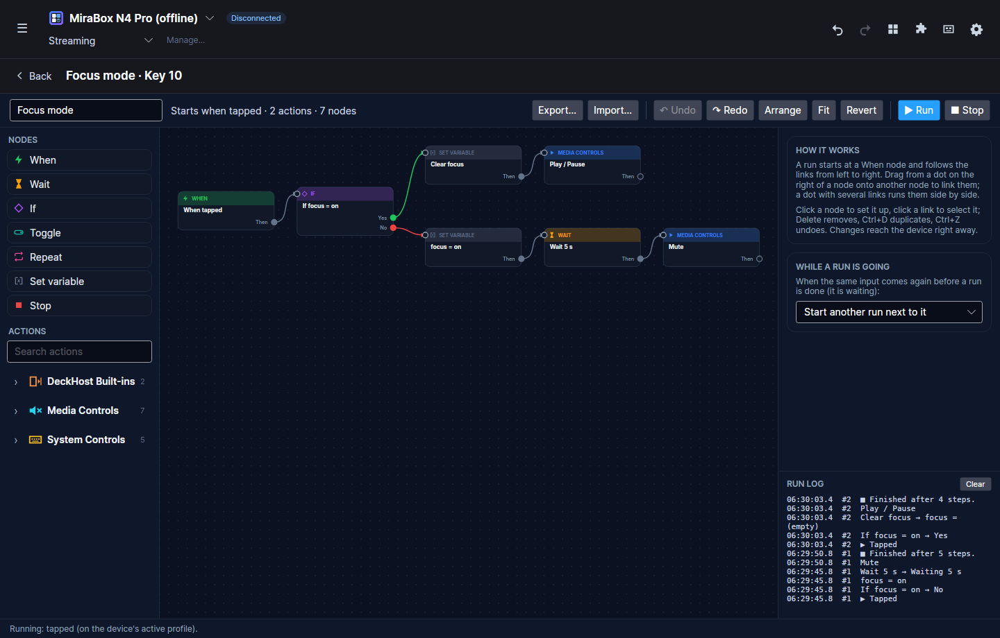
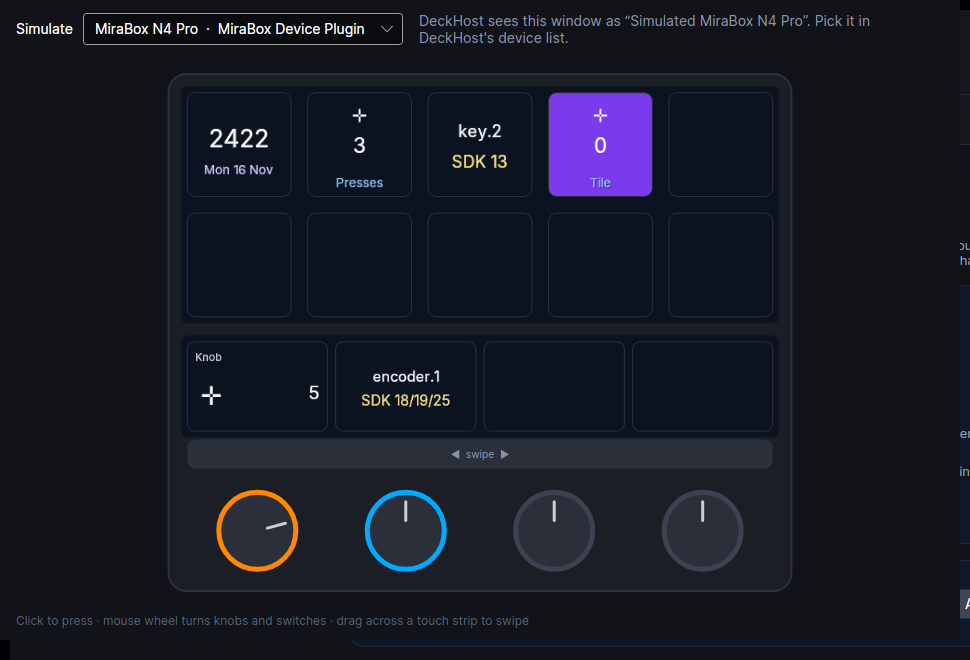
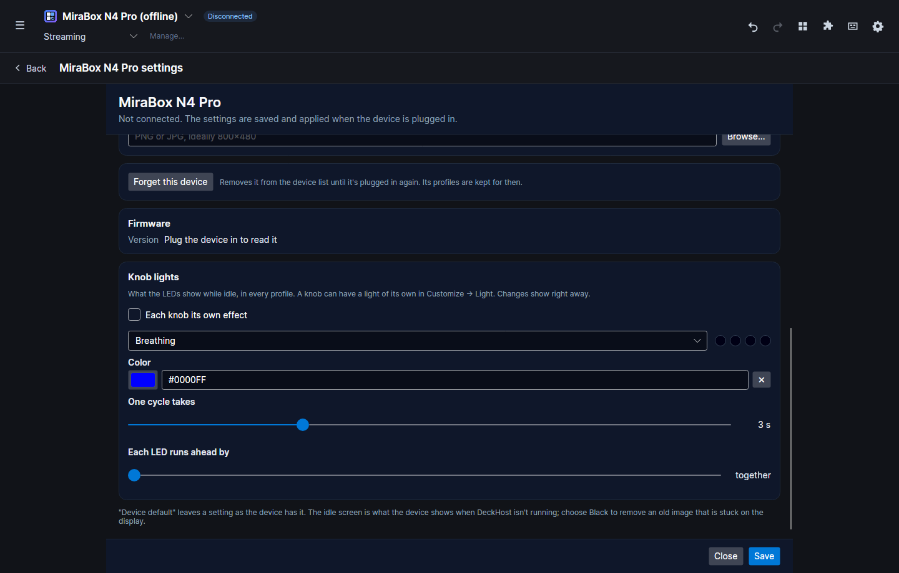
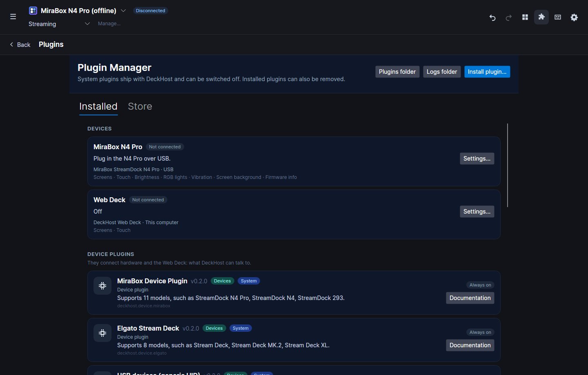

<p align="center"></p>

# DeckHost

[](https://github.com/vman26/DeckHost/releases)
[](https://github.com/vman26/DeckHost/releases)
[](LICENSE)
[](https://vman26.github.io/DeckHost/)
[](https://buymeacoffee.com/Vman26)

DeckHost is a free, open-source host for physical control surfaces (macro pads, rotary consoles, touch strips) on Windows, Linux and macOS. It separates the hardware from the actions: device plugins drive the hardware, application plugins provide the actions, and the editor lets you map one onto the other.

- **Devices:** the **MiraBox / StreamDock N4 Pro** (10 LCD keys, a touch strip with 4 zones and swipe, 4 knobs with RGB rings) and the other StreamDock models (N4, 293, 293s, M18, XL, M3, N3, N1, K1 Pro, Mini; preview), **Elgato Stream Decks** (MK.2, XL, Neo, +, Pedal, Mini, the first edition; preview), a **Web Deck** on your phone or tablet, **other USB devices** you teach it in the device creator, and a **device simulator** that acts like any of them without the hardware.
- **Actions:** media, volume, apps, hotkeys, profiles, pages and folders; Multi Action, Key Logic and visual **workflows**; DeckHost plugins and thousands of **Stream Deck and OpenAction plugins**.
- **Documentation:** [vman26.github.io/DeckHost](https://vman26.github.io/DeckHost/).

<p align="center"></p>

<table>
  <tr>
    <td width="50%"><a href="docs/images/workflow.png"></a><br><sub><b>Workflows:</b> build what a key does from linked nodes, with live highlighting of each step.</sub></td>
    <td width="50%"><a href="docs/images/simulator.png"></a><br><sub><b>Device simulator:</b> try any supported device without the hardware.</sub></td>
  </tr>
  <tr>
    <td width="50%"><a href="docs/images/lights.png"></a><br><sub><b>Lights:</b> an effect per device or per knob.</sub></td>
    <td width="50%"><a href="docs/images/plugins.png"></a><br><sub><b>Plugins:</b> DeckHost, Stream Deck and OpenAction plugins, with a store.</sub></td>
  </tr>
</table>

## How DeckHost is made

DeckHost is built by me, Marco, with a lot of help from **Claude**, an AI coding assistant (that's why many commits and pull requests say "Co-Authored-By: Claude" or "Generated with Claude Code"). I decide what DeckHost does and how it's designed, review the changes, and test them, on real hardware where I have it. The safety nets are public: 600+ automated tests, CI on Windows, Linux and macOS for every change, and the [design decisions](docs/maintainers/adr/index.md) written down.

I'm saying this up front because you should know how the software you run is made. If something is wrong, it's mine to fix: [report it](https://github.com/vman26/DeckHost/issues/new/choose). Contributions, AI-assisted or not, are welcome under the same rules ([CONTRIBUTING](CONTRIBUTING.md)).

## Core architecture
- **Hardware decoupled:** the core only talks to `IDevicePlugin` / `IDeviceOutput`. Everything device-specific (SDK ids, image sizes, LEDs, native calls) lives in the device plugin.
- **Per-control rendering:** each key and touch zone is rendered on its own with SkiaSharp and pushed only when its pixels changed. Render buffers, paints and fonts are reused between frames.
- **One runtime worker:** input, actions, rendering and USB I/O run on a single background worker, so native SDK callbacks return immediately and the UI thread never waits on the device.
- **Reactive state:** a thread-safe Rx.NET variable store connects actions and renderers.
- **Saved profiles:** mappings are stored in `%AppData%/DeckHost/profiles.json` (or the platform equivalent).
- **Cross-platform:** .NET 10 and Avalonia UI on Windows, Linux and macOS (Apple Silicon). Windows is the primary development platform.

## Download and install

**[Download DeckHost](https://vman26.github.io/DeckHost/download/)** picks the package for your system. All releases are on the [**Releases** page](https://github.com/vman26/DeckHost/releases), one package per platform:

| Platform | Package | Install |
|---|---|---|
| Windows 10/11 (x64) | `DeckHost-<version>-win-x64-install.exe` | Run it. Installs for your user (no administrator rights), with a Start menu entry and uninstaller. For all users: the `.msi`; a plain `.zip` is there too. To pick the folder: `install.exe --installto <folder>` or `msiexec /i <msi> VELOPACK_INSTALLDIR=<folder>` ([details](https://vman26.github.io/DeckHost/download/#install-in-another-folder)). It isn't code-signed yet: when Windows says "Windows protected your PC", choose **More info → Run anyway**. |
| Linux (x64) | `DeckHost-<version>-linux-x64.tar.gz` | Unpack and run `./install.sh`: installs to `~/.local/share/deckhost` with a menu entry, and (with sudo, once) the udev rule that lets you use the N4 Pro and Elgato Stream Decks without root. `./install.sh --uninstall` removes it. |
| Linux (x64), no install | `DeckHost-<version>-linux-x86_64.AppImage` | `chmod +x` it and run it. The udev rule is installed once by hand ([notes](https://vman26.github.io/DeckHost/devices/#linux-appimage)). |
| macOS 12+ (Apple Silicon) | `DeckHost-<version>-osx-arm64.zip` | Unzip and move **DeckHost.app** to Applications. It isn't notarized: the first time, right-click → **Open** (macOS 15 and newer: open it once, then **System Settings → Privacy & Security → Open Anyway**), or run `xattr -dr com.apple.quarantine /Applications/DeckHost.app`. |

`SHA256SUMS.txt` lists the checksums, and every file has a build provenance attestation (`gh attestation verify <file> --repo vman26/DeckHost`). An antivirus program blocks DeckHost? See [what to do](https://vman26.github.io/DeckHost/troubleshooting/#if-your-antivirus-blocks-deckhost). To check that the device support is installed without opening the window, run DeckHost with `--check-native`: it loads the native bridge and lists the StreamDock devices it finds.

### What works where

| | Windows | Linux | macOS |
|---|---|---|---|
| N4 Pro (keys, touch strip, knobs, LEDs, settings) | ✓ | ✓ (udev rule) | ✓ |
| Other StreamDock models: keys, buttons, knobs, small displays (preview) | ✓ | ✓ (udev rule) | ✓ |
| Elgato Stream Deck: MK.2, Original v2, XL, Neo, +, Pedal (preview, see below) | ✓ | ✓ (udev rule) | ✓ |
| Web Deck: keys on a phone, tablet or browser window | ✓ | ✓ | ✓ |
| Media keys, volume | ✓ | playerctl; wpctl, pactl or amixer | ✓ (volume HUD) |
| Hotkey, Type Text | ✓ | xdotool (X11) or wtype (Wayland) | ✓ (Accessibility permission) |
| Lock computer | ✓ | loginctl or xdg-screensaver | ✓ (Accessibility permission) |
| Volume Knob level on the touch strip | ✓ | wpctl, pactl or amixer | ✓ |
| Automatic profile switching | ✓ | X11 / XWayland apps, needs xprop | ✓ |
| Start at sign-in, tray | ✓ | XDG autostart; tray needs a StatusNotifier host (KDE, most desktops; GNOME with the AppIndicator extension) | ✓ (LaunchAgent) |
| Stream Deck plugins (native and Node.js) | ✓ | ✓ when the plugin ships a Linux build | ✓ when the plugin ships a macOS build |
| Stream Deck plugin settings pages inside DeckHost | ✓ (WebView2) | ✓ (WebKitGTK, `libwebkit2gtk-4.1`; else in your browser) | ✓ (WKWebView) |
| Stream Deck HTML plugins (plugins that run in a web page) | ✓ (WebView2) | don't run | don't run |

### Light on your computer

DeckHost runs all day, so every pull request and release is measured on Windows, Linux and macOS
(GitHub's runners, a simulated N4 Pro with a clock and live CPU and memory keys), and a change that
goes over its budget doesn't get in:

| CPU, % of one core | Windows | Linux | macOS |
|---|---:|---:|---:|
| In the tray (how it spends most of the day) | 0.6–0.9 | 0.5–0.6 | 1.1–1.2 |
| Window open, nothing pressed | 2.5–3.1 | 1.6–1.9 | 2.1 |
| Press → new key image (95th percentile) | 2 ms | 2–7 ms | 11 ms |

Memory is about 150–250 MB. The numbers for each release are on the
[Performance](https://vman26.github.io/DeckHost/performance/) page.

### Elgato Stream Deck and the Web Deck

DeckHost talks to Elgato Stream Decks directly over USB, without Elgato's software. Close the Stream Deck app first: it keeps the device to itself. Each deck you plug in appears in the device picker in the header (with its own profiles) and stays listed while unplugged. The models of the current generation are supported (Stream Deck MK.2 and Original v2, XL, Neo, Stream Deck + with its dials and touch strip, Pedal) and the older ones (first-edition Stream Deck, Stream Deck Mini). This support is new and was written from the protocol, not yet tested on every model: please report what works.

**Other USB devices** (button boxes, pedals, jog wheels, game controllers, macro pads with a readable HID interface) become decks through **☰ → Add a USB device**: pick the device, press each key and turn each knob once so DeckHost learns them, place them as they sit, and save. They only send input; Windows doesn't let any program read keyboards and mice directly.

The **Web Deck** is a deck in a web browser. Pick *Web Deck* in the device picker, open **Device settings** and choose *This computer only* (an on-screen deck in a browser window) or *Phones and tablets on this network*, the number of columns and rows, then open the address shown there on the phone and enter the pairing code (and the PIN, if you set one). **New pairing code** disconnects every phone that used the old one. On a phone, "Add to Home Screen" makes it a full-screen app. Allow DeckHost through the firewall when your system asks, or the phone can't reach it.

On Linux, "close to tray" starts off, since not every desktop shows a tray icon; turn it on in DeckHost settings if yours does. The Linux tools above are optional: an action whose tool is missing shows which one to install.

## Building from source

### Prerequisites
- [.NET 10 SDK](https://dotnet.microsoft.com/download/dotnet/10.0)
- CMake 3.21+ and a C++20 compiler (MSVC on Windows; Visual Studio's bundled CMake is detected automatically; GCC or Clang on Linux; Xcode command line tools on macOS)
- Linux only: OpenCV, giflib and libudev development packages (Ubuntu: `libopencv-dev libgif-dev libudev-dev`), or a static OpenCV from `scripts/build-opencv-static.sh` (what releases use).

### Steps
```powershell
git clone --recursive <repository-url>
cd DeckHost
dotnet build .\DeckHost.slnx -c Debug
dotnet run --project .\DeckHost.App
dotnet test .\DeckHost.Tests
```

`dotnet build` also configures and builds the native bridge (`native/MiraBoxBridge`) with CMake and copies it into the bundled MiraBox plugin (`plugins/bundled/deckhost.device.mirabox/` next to the app). To build only the C# code, add `-p:EnableMiraBoxNativeBuild=false`; the app then starts without device support.

The tests run on all three systems. On Linux, to build against the static OpenCV releases use:

```bash
scripts/build-opencv-static.sh ~/opencv-static
dotnet build DeckHost.slnx -p:MiraBoxCMakeArgs=-DOpenCV_DIR=$HOME/opencv-static/lib/cmake/opencv4
```

### Versions and releases

Versions come from git ([GitVersion](https://gitversion.net), rules in `GitVersion.yml`) and follow [SemVer](https://semver.org). Tags are releases; between releases, **the branch you work on** says what comes next, so nothing is guessed:

| Where you work | Builds as | Meaning |
|---|---|---|
| tagged `v1.3.0` | `1.3.0` | a release |
| `develop`, `feature/*` | `1.4.0-alpha.N+4b09090` | work towards the next minor |
| `bugfix/*` | like the branch it starts from: from `develop` `1.4.0-alpha.N`, from a release `1.3.1-alpha.N` | a fix |
| `hotfix/*`, from a release | `1.3.1-beta.N`; `hotfix/1.3.5` builds `1.3.5-beta.N` | the next patch |
| `release/1.4.0` | `1.4.0-rc.N` | getting 1.4.0 ready |
| a commit message with `+semver: major` (or `minor`, `patch`) | `2.0.0-alpha.N` on `develop` | a bigger (or smaller) step than the branch implies |
| any other branch | like the branch it starts from, label `alpha` | |
| before the first tag | `0.1.0-alpha.N+…` | |

- `N` counts the commits since the version's starting point (the last tag, or where a release branch began). It only counts; two branches can show the same number, which is why the commit is added.
- Once a `release/*` branch exists, `develop` moves on to the minor after it (`release/1.4.0` → `develop` builds `1.5.0-alpha.N`).
- Every version that isn't a release ends in `+<commit>`: the first 7 characters of the commit it was built from (`git show 4b09090`). Release versions don't need it, the tag points at the commit.
- Package file names use `-` instead of `+` (`DeckHost-1.4.0-alpha.3-4b09090-linux-x64.tar.gz`), since GitHub renames some characters in release files.
- The app shows its version in **☰ → DeckHost settings** and in the log. Builds need the full git history (not a shallow clone); a source archive without `.git` builds as 1.0.0.

To release, tag and push:

```bash
git tag v1.4.0
git push origin v1.4.0
```

The tag is the version. The **release** workflow then tests and publishes DeckHost self-contained for Windows, Linux and macOS, checks the native bridge in each package (`--check-native`), packages them (Windows installer and zip, Linux tarball, macOS app) and creates the GitHub release with notes and checksums. A tag with a suffix (`v1.4.0-rc.1`, `v1.3.1-beta.1`) becomes a pre-release; use the label of the branch you tag on (`rc` on `release/*`, `beta` on `hotfix/*`), so the builds after it count on from it. Run the workflow by hand to get the packages as build artifacts without releasing.

**Updates in the app** come from these releases: DeckHost asks GitHub's public API for the releases of the repository it was built for (`api.github.com/repos/<owner>/<repo>/releases`, no sign-in), takes the newest one whose tag is a higher version than its own, and downloads that release's package for the system (see [DeckHost settings and the tray](#deckhost-settings-and-the-tray)). A fork builds against its own releases (the build property `DeckHostUpdateRepository`, set by the release workflow to the repository it runs in).

**Download counts:** GitHub counts every download of a release file. `scripts/downloads.sh` lists them per release and file, with the total (`scripts/downloads.sh vman26/DeckHost`).

The usual flow (git-flow):

- **Features:** branch `feature/*` from `develop`, merge back. For a release: branch `release/1.4.0` from `develop`, fix and tag `v1.4.0-rc.1`, … as needed, merge it into `main`, tag `v1.4.0` there, and merge `main` back into `develop`.
- **Urgent fix for a release:** branch `hotfix/*` from `main` (or from the tag, `git switch -c hotfix/usb v1.3.0`), merge into `main`, tag `v1.3.1`, merge `main` back into `develop`.
- **Next major:** put `+semver: major` in a commit message on `develop` when the breaking work lands.

## Plugins

DeckHost ships with three **system plugins**. You can switch them off in the Plugin Manager, but you can't uninstall them:

| Plugin | Actions |
|---|---|
| DeckHost Built-ins (always on) | Multi Action, Multi Action Switch, Key Logic, Pages, Folder, Back, Switch Profile, Clock, Counter, Key ID (Diagnostic) |
| Media Controls | Play / Pause, Next, Previous, Stop, Volume Up / Down, Mute, Volume Knob, Track Swipe |
| System Controls | Launch App, Open Website or File, Hotkey, Type Text, Lock Computer, System Info (CPU, memory, disk, uptime) |

On the device the actions are drawn as an icon in the action's color on the profile background, with a short caption only where the icon needs one (the app to launch, the site, the hotkey). In the editor a control can get the action's colored tile (like a Stream Deck key) or a color of its own instead; your own text becomes the caption and your own image or icon replaces the action's icon. Stream Deck plugin images lose their black background (black that touches the edge of the picture), so the backgrounds show around them; black inside a picture stays. On the touch strip, readouts (volume, CPU, a counter, Stream Deck dials) are laid out like a Stream Deck +: the name small at the top left, the icon on the left, the value on the right with a thin level bar under it.

Media keys, hotkeys, typing and locking use Windows `SendInput`, the tools listed under "What works where" on Linux, and system key events on macOS.

### The main window

The window is laid out like the Stream Deck app:

- **Header:** the ☰ menu, the device with its connection state, the **profile picker** (and **Manage…**), an update notice when there is one, and buttons for **Test** mode, Profiles, Plugins and store, Device settings and DeckHost settings.
- **The device** on top, at a fixed size, so it doesn't move when you open plugin groups or the editor (drag the divider below it for more or less room).
- **The editor** below the device for the control you select: click a control and set it up right there (what used to be the Customize window). Changes show on the device right away; **Revert** puts the control back as it was when you selected it, **Remove** clears it.
- **Actions** on the right, grouped by plugin like the Stream Deck app: each plugin and action with its icon, groups folded until you open them (a search opens every match). Drag an action onto a control; while you drag, its icon and name follow the pointer.
- Settings, plugins, profiles, device settings and the update notes open as pages inside the window; **Back** (or Esc) returns.
- **DeckHost settings → Show the debug panel** adds a panel with the selected control's inputs and outputs, the runtime connection and the runtime log.

**Pages and folders**, like the Stream Deck app:

- **Pages:** a profile can have several pages of keys. **+** under the device adds one; the numbers switch between them (right-click one to remove it). On the device, the **Pages** action goes to the next, the previous or a specific page (on a knob: turn to flip through them), and swiping a touch strip that has no action of its own flips pages like a phone (swipe left for the next page).
- **Folders:** drop the **Folder** action on a key and it gets a layout of its own, with a **Back** key in its first key. Press it on the device, double-click it, or use **Open folder** in its editor to fill it; **Back** under the device (or the Back key) returns. Folders can hold folders. Removing the Folder key removes its folder.
- Profile switching (Switch Profile, apps) always lands on a profile's first page; pages and folders use the profile's background unless they get their own.

**Sharing and backups** (Profiles page):

- **Export…** writes the profile with its pages, folders and images to a `.deckhostprofile` file; **Import…** adds one as a new profile (it never replaces one you have).
- **Import…** also takes an Elgato **`.streamDeckProfile`**. Keys and dials keep their place (as far as the device has room), their title and image; pages and folders come along. Elgato's own actions become DeckHost's (hotkey, website, open, text, multimedia, pages, folders, Multi Action, Multi Action Switch), installed Stream Deck plugins keep their actions (set their options again), and anything DeckHost doesn't have keeps its look, listed after the import. Hotkeys come in as Hotkey actions without their keys.
- **Backups:** all profiles are backed up once a day (14 days kept) in `backups/` next to `profiles.json`; **Back up now** and **Restore** are on the Profiles page.

**Key logic**, also like the Stream Deck app:

- **Multi Action Switch:** two sets of steps; the first press runs the first set, the next press the second, and so on (mute, then unmute). Each step's **Runs on** picks its set; the key shows which set comes next (with your own title per set if you like).
- **Key Logic:** up to three things on one key: **Press**, **Double press** and **Hold**. With double-press steps, a single press waits 0.3 s to see whether a second one follows; without them it runs at once.
- **Wait before:** every step of a Multi Action, a switch or Key Logic can wait first (in milliseconds). The device keeps working while a step waits.

**Testing in the editor:** double-click a control to press it (it runs the real action, as the device would), and scroll over a knob to turn it. Double-clicking the left or right half of the swipe bar swipes it.

Actions with settings (the app to launch, a hotkey, a scene name, ...) are set up in the editor. A **Multi Action** shows its steps there: drop actions from the list onto the steps to add them exactly where you drop them, drag **⠿** to change the order, or use **Or choose an action** / **Add step**. Dropping an action onto the control itself adds it as the last step. For a Hotkey, click **Record** and press the combination.

Drag a mapped control onto another control to move it (the two swap if the target is taken), hold **Ctrl** to copy it, or drop it on an empty area to remove it.

## Profiles

Profiles are the pages of a device. **☰ → Open Profile Manager** (or **Manage…** next to the profile list) creates, duplicates, renames, reorders and deletes them. The order is also what the Next/Previous Profile actions follow.

**Automatic switching (Windows, macOS, Linux on X11):** give a profile one or more apps (process names such as `obs64` or `chrome`, or pick a running app) and it becomes active while that app's window is in front. When the focused app isn't listed anywhere, DeckHost returns to the profile you picked yourself. DeckHost's own windows never trigger a switch. Turn it off with the switch in the Profile Manager or the ☰ menu.

Duplicating a profile copies everything: bindings, action settings, Stream Deck plugin settings, apps and background.

### Customizing a control

**The editor** (select a control) sets:

- **Run when** (for actions that normally run on a press): only the inputs the control has, so a key offers press, release and long press, a knob also turned left/right, and the swipe bar swiped left/right.
- **Per input** (actions that support it, such as Switch Profile): on a control with more than one input, a group of settings for each input: **When pressed**, **When held down**, **When turned left/right**, **When swiped left/right**. For example a knob that goes to a specific profile when pressed and steps back and forth through the profiles when turned. "Do nothing" leaves an input unused.
- **Text**: multi-line, wrapped or not, with color (picker or hex), font, size, bold, italic, and horizontal (left/center/right) and vertical (top/middle/bottom) alignment.
- **Icon**: **Choose…** opens the icon picker (see [Icons](#icons)). The icon takes the place of the action's own on its tile; single-color icons are drawn in white.
- **Image**: PNG, JPG, animated GIF or SVG, with a **Clear** button.
- **Background**: **Transparent** (the default: the profile background shows behind the icon, which is drawn in the action's color, or in the text color when one is set), **The action's colored tile** (with its own color or gradient and corners from square to round), or **A color of my own**. A color has an **Opacity** slider (and **Transparent**) and is stored as `#AARRGGBB` below 100 %.
- **Colors** everywhere use one picker: a saturation/brightness square, hue and opacity sliders, HEX and R/G/B boxes, preset colors and an **eyedropper** that picks a color from anywhere on the screen (click, Space or Enter takes it; Esc cancels). The eyedropper works on Windows, on macOS (it needs the Screen Recording permission, else it only sees the desktop picture) and on Linux with X11; Wayland doesn't let apps read the screen.
- The action's own settings, and for knobs their light: by default the device's **Knob lights**, or **its own light**: an idle light (any effect below, or one you compose) and a color while it's used. Numeric settings have a slider with a number box next to it for exact values, and **↺** to go back to the default.

### Icons

The icon picker (editor → Icon → **Choose…**) searches two places:

- **My packs**: icon packs you installed with **Install icon pack…**: a Stream Deck icon pack (`.streamDeckIconPack`, as made for Elgato's Stream Deck app, from the Elgato Marketplace or e.g. GitHub), or a zip or folder of images. Packs are listed with their author, version and license, and can be removed.
- **Online (Iconify)**: [Iconify](https://iconify.design)'s free, open-source icon sets (Material Design, Lucide, Tabler, brand logos, ...), shown with each set's name and license. A picked icon is saved into a local "Downloaded icons" pack, with its set's license in its `license.txt`, so profiles keep working offline.

**Use as icon** puts it on the action's tile (with the caption); **Use as picture** fills the key, like an image file. Colored pack icons are usually made as whole key pictures; the picker suggests that for them. Check an icon's license before sharing a profile that uses it.

### Knob lights

The N4 Pro has an LED ring around each knob. **Device Settings → Knob lights** sets what they show while idle, in every profile, with a live preview next to the effect:

- **Off**, **Steady color**, **Breathing**, **Heartbeat** (two beats and a rest), **Blink**, **Color cycle** (fades through a list of colors you pick), **Rainbow**, **Wave** (a band of light running across the knobs), **Chase** (a light with a fading tail running from knob to knob), **Candle** (a warm flicker) and **Sparkle** (random twinkles).
- **Custom** is an effect composer: a list of steps, each a color with how long to fade to it and how long to hold it, played in order and then from the start. Start from a preset (Police, Sunset, Ocean, Traffic light, Fire, Alert) or add your own steps, and reorder them with the arrows.
- **One cycle takes** sets the speed, and **Each LED runs ahead by** spreads an effect over the knobs (0 % lights them all the same).
- **Each knob its own effect** gives every LED its own effect, colors or composed steps (a tab per knob).

Effects run at about 30 frames a second, and fades follow a gamma curve so they look even to the eye. Steady lights are sent again every few seconds and after the device applies its settings. **Off** dims the LEDs (brightness 0) instead of sending black: the N4 Pro's firmware shows its own rainbow when every LED is set to black. A knob can have its own light instead (the control editor → Light, the same light editor), and lights up in its "when used" color for a moment when it's turned or pressed. The editor shows each knob with its LED ring in the color the device shows right now, effects included, also while the device is unplugged.

### Knobs on the touch strip

The N4 Pro's knobs have no screen of their own, so like on a Stream Deck +, each knob shows its action on the touch zone above it:

- **Touch zone empty:** the knob's action fills the zone, for example the Volume Knob shows the volume and a level bar. Tapping the zone then works like pressing the knob.
- **Touch zone has its own action, text or image:** the zone keeps it, and the knob gets a one-line strip along its bottom edge. A tap stays with the zone. A background color alone doesn't count: the knob then fills the zone on that color.
- **Show this on Touch N** (the knob's editor) turns this off for a knob, leaving the zone to its own action.

Text, image and text style set on a knob are used there too. Actions that show a value (Volume Knob, Clock, Counter, System Info, and Stream Deck dial actions through `setFeedback`) draw it as a compact one-liner in the strip.

### Plugin store and Stream Deck plugins

**☰ → Open Plugin Manager** (or **Plugins…** next to the action search) → **Store** shows one list, which you can filter by source, category, status and search text:

- **DeckHost**: the [DeckHost plugin catalog](https://github.com/vman26/deckhost-plugins) (one file per plugin, added by pull request; see [the catalog guide](docs/maintainers/plugin-store.md)), plus the sources under **Store → Sources**, one per line. A source is a catalog URL, a local catalog file, or a local folder such as `E:\Projects\DeckHost\plugins`. Folders are searched for packages (`.zip`, `.dhplugin`, `.streamDeckPlugin`) and built plugin folders (a `plugin.json` next to its assembly, e.g. a project's `bin` output), so plugins you are developing show up without packaging them. A catalog is a JSON object keyed by plugin id (or an array) with `name`, `author`, `description`, `version`, `category`, `download_url`, `repository` and `icon`. Entries can also carry `sha256` (a download that doesn't match is refused), `permissions` (shown in the store), and for paid plugins `purchase_url` and `price` (the store shows **Buy**). The list is saved in `%AppData%/DeckHost/store.json`.
- **OpenAction**: the open-source Stream Deck plugin catalog (`openactionapi.github.io/plugins`). Packages come from the plugin's download link or its latest GitHub release.
- **Elgato (community archive)**: an archive of Elgato Marketplace plugins (`plugins.amankhanna.me`). Elgato has no public store API.

The catalogs have no categories, so DeckHost derives one from each plugin's name and description (a category from the catalog or the plugin's manifest wins). **Page** opens the plugin's page: the repository for OpenAction plugins, the Elgato Marketplace for Elgato plugins. Stream Deck plugins from both sources install into the same Stream Deck folder, since they are the same kind of plugin.

Each plugin shows its icon (OpenAction's icons, the archive's copies of the Elgato icons, a catalog's `icon`, or an installed plugin's own icon). **More ▾** expands a plugin in the list and shows its README from its GitHub repository, rendered with its images, badges, tables and links (links open in your browser). Plugins without a GitHub repository show their description, and **Page** still opens the plugin's page. Icons and README images are cached in `%LocalAppData%/DeckHost/cache/store`.

Installing, uninstalling and enabling run in the background; the Plugin Manager shows each step (downloading with a percentage, unpacking, starting, stopping, removing files). The Installed tab shows where each plugin came from.

Stream Deck plugins run through DeckHost's Stream Deck compatibility layer:

- Each plugin starts as its own process (native `.exe` or Node.js) and talks to DeckHost over the standard Stream Deck SDK WebSocket protocol.
- N4 Pro keys act as Stream Deck keys and the knobs as Stream Deck+ dials.
- `setTitle`, `setImage` (PNG, JPG and SVG), `setState`, settings and global settings work. Dial actions' `setFeedback` (title, value and indicator bar) is shown on the knob's touch zone.
- HTML-based plugins (whose code is a web page) run in a hidden built-in browser page, as in the Stream Deck app. Their console output goes to the DeckHost log.
- A plugin's own settings page (property inspector) opens inside the editor through the system's web view: WebView2 on Windows (Windows 10/11 include it), WKWebView on macOS, WebKitGTK on Linux (`libwebkit2gtk-4.1`, on most desktops). **Open in browser** is there as a fallback, and the editor offers it when no web view starts.

Limits:

- Node.js plugins need Node.js 20 or newer.
- Settings are kept per device, profile and control.

You can also install a `.streamDeckPlugin` file with **Install plugin…**.

### Device settings

**☰ → Device settings** (or **Settings…** next to a device in the Plugin Manager) holds the device plugin's own settings. For the N4 Pro: vibration, the start-up animation, LED and key-light behavior, screen and LED brightness, and the **idle / start-up screen** the device shows when DeckHost isn't running. Settings start at their default (switches on, brightness 100), which DeckHost doesn't send until you change something; setting a value back to its default sends the default once, so the device really returns to it. After writing the idle screen DeckHost sends all key images again. If an old image is stuck on the display when DeckHost is closed, set the idle screen to **Black** (or pick an image) and save. Settings are stored in `%AppData%/DeckHost/devices/<device>.json` and applied again whenever the device connects.

### DeckHost settings and the tray

**☰ → DeckHost settings** (or **Settings…** in the tray menu):

- **Start DeckHost when I sign in**: Windows: the `HKCU\…\Run` key; Linux: `~/.config/autostart/deckhost.desktop`; macOS: a LaunchAgent (`~/Library/LaunchAgents/app.deckhost.DeckHost.plist`). No admin rights needed.
- **Start in the tray when started at sign-in**: the device works without the window.
- **Closing the window keeps DeckHost running in the tray**: use **Exit** in the tray menu to quit.
- **Support DeckHost**: a **Buy me a coffee** button (and its QR code for your phone) for buymeacoffee.com/Vman26.
- **Updates**: **Check for updates automatically** (on by default: 15 seconds after start and every 6 hours) asks GitHub for a newer release; **Include pre-releases** (on by default when you run one) also offers alpha, beta and rc builds; **Check now** checks right away. A new release shows a notice at the top of the main window (and an item in the tray menu): **What's new** lists the release notes of every release since yours, then **Install and restart** downloads the package for your system, checks it against the release's `SHA256SUMS.txt`, closes DeckHost, installs and starts the new version (Windows: the setup, silently when DeckHost was installed with it; Linux and macOS: the install folder or `DeckHost.app` is replaced). Where DeckHost can't replace itself (a folder you can't write, or a development build), the button is **Download** and the file is shown so you can install it like the first time. **Skip this version** stops the notice until a newer release; **✕** / **Later** hides it until the next start.

The settings page also shows DeckHost's version.

Only one DeckHost runs at a time: starting it again shows the running one. (Two instances would both read the device and run every action twice.)

### Folders and logs

`%AppData%` is `~/.config` on Linux and `~/Library/Application Support` on macOS.

| What | Where |
|---|---|
| Log files (NLog, one per day, kept 14 days) | `%AppData%/DeckHost/logs/deckhost-<date>.log` |
| Stream Deck plugin output | `%AppData%/DeckHost/logs/plugins` |
| DeckHost plugins | `%AppData%/DeckHost/plugins/functional/<id>` |
| Stream Deck plugins | `%AppData%/DeckHost/plugins/streamdeck/<uuid>.sdPlugin` |
| Profiles | `%AppData%/DeckHost/profiles.json` |
| Icon packs and downloaded icons | `%AppData%/DeckHost/icons/<pack id>` (Stream Deck icon pack layout) |

The Plugin Manager shows these paths and has **Plugins folder** and **Logs folder** buttons.

### Backgrounds, live preview and test mode

- **Backgrounds:** a profile can have a background color and an image or animated GIF that spans all keys (Profile Manager). Each control can have its own background color, and its image can be an animated GIF (the control editor). GIFs play at about 10 frames per second. The profile's background color also fills the screen between the keys, as a temporary background that covers the device's idle screen while DeckHost runs; the idle screen comes back when DeckHost exits. A background *image* is drawn on the keys and zones only.
- **Live preview:** the canvas shows the exact images that are on the device, even when it's unplugged, and lights up controls as you press them.
- **Test mode** (canvas header): click controls to press them, use the mouse wheel to turn knobs, and click the left or right half of the swipe bar to swipe. The real actions run.

### Installable plugins

Other plugins are installed from a package with **☰ → Open Plugin Manager → Install plugin…**. A package is a `.zip` with a `plugin.json` and the plugin's assemblies:

```json
{
  "id": "deckhost.plugin.obs",
  "name": "OBS Studio",
  "version": "1.0.0",
  "author": "DeckHost",
  "description": "…",
  "assembly": "DeckHost.Plugin.Obs.dll",
  "hostApiVersion": 1,
  "icon": "icon.png"
}
```

`icon` is optional: an image in the package (PNG, JPG or SVG) that the Plugin Manager and the store show.

The assembly must contain a public `IApplicationPlugin` with a parameterless constructor whose `Id` matches the manifest. It must not ship its own copy of `DeckHost.Contracts`. Installed plugins live in `%AppData%/DeckHost/plugins/functional/<id>`. Plugins run with your user's rights, so only install packages you trust.

`plugins/DeckHost.Plugin.Obs` is an example: OBS Studio control through obs-websocket 5 (OBS 28+). It can switch scenes, toggle mute, toggle streaming and recording, and save the replay buffer. Build it with `dotnet build .\plugins\DeckHost.Plugin.Obs` and install `artifacts\plugins\deckhost.plugin.obs.zip`. Then enter the OBS WebSocket password in each OBS action's settings (OBS: Tools → WebSocket Server Settings).

### Firmware

The Plugin Manager shows each device's serial number and firmware version. The StreamDock SDK can read the firmware version but has no function to update it, so firmware updates still go through MiraBox's own Stream Dock software.

## StreamDock SDK patch

`native/StreamDock-SDK` is pinned to an upstream commit. The local fixes it needs are kept in `native/patches/streamdock-sdk.patch`, and the build applies them automatically (it checks first, so applying twice is harmless).

To apply or check the patch by hand:

```powershell
powershell -ExecutionPolicy Bypass -File .\scripts\Apply-StreamDockSdkPatch.ps1
powershell -ExecutionPolicy Bypass -File .\scripts\Apply-StreamDockSdkPatch.ps1 -CheckOnly
```

When you update the submodule and the patch no longer applies, regenerate it against the new upstream commit with `git -C native/StreamDock-SDK diff > native/patches/streamdock-sdk.patch` after fixing the files.

## MiraBox key mapping

The SDK numbers the N4 Pro's keys from the bottom-left, so the top row is SDK keys 11–15 and the bottom row 6–10. Each model's numbering is in `DeckHost.Device.MiraBox/MiraBoxModels.cs`, taken from the SDK's device classes. If an image appears on the wrong key on your unit, assign the **Key ID (Diagnostic)** action to the keys and adjust that model's entry (and please report it).

## Contributing

Bug reports, ideas, device support, plugins and fixes are welcome: see [CONTRIBUTING](CONTRIBUTING.md). Plugins are listed in the [DeckHost plugin catalog](https://github.com/vman26/deckhost-plugins). Security problems: [SECURITY](SECURITY.md).

## License

DeckHost is free software under the **GNU General Public License v3.0 or later** ([`LICENSE`](LICENSE)): you may use, study, share and change it; changed versions you share must stay under the GPL too.

The **plugin API** (`DeckHost.Contracts`) and the plugin template are **MIT**, and an additional permission lets plugins of any license, free or paid, run with DeckHost: see [`NOTICE.md`](NOTICE.md).

## Trademarks

Stream Deck is a trademark of Corsair Memory, Inc. / Elgato, and DeckHost is an independent project
not affiliated with or endorsed by Elgato. StreamDock is a trademark of MiraBox; DeckHost is not
affiliated with or endorsed by MiraBox either. Other product names belong to their owners and are
used only to say which devices and plugins DeckHost works with.
