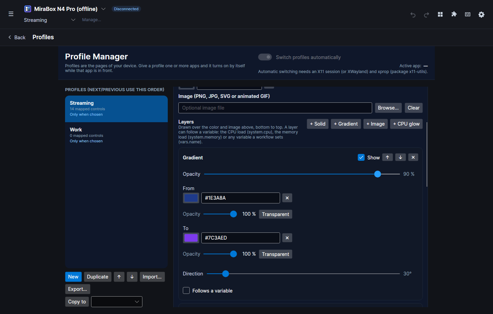
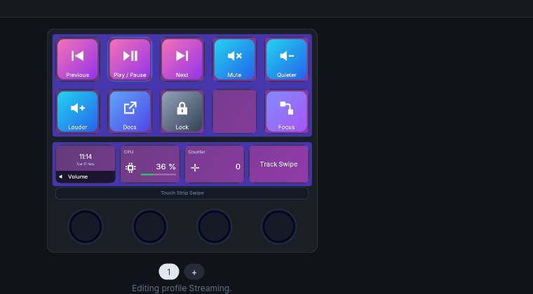

# Backgrounds

A profile's background is a color, an image, and any number of **layers** drawn over them, bottom to top. Set it on the **Profiles** page (the grid icon at the top right): **Background of this profile**, or **Default background for all profiles** for every profile that has none of its own. Pages and folders look like their profile.

The color and image are the bottom of the picture; **Layers** adds more on top:

| Layer | What it draws |
|---|---|
| **Solid** | One color over the whole layout (with its opacity; `#AARRGGBB` colors work too). |
| **Gradient** | A gradient across the whole layout, from one color to another at an angle (0° left to right, 90° top to bottom). Every key shows its own part, so neighbouring keys continue each other. |
| **Image** | A picture (PNG, JPG, SVG or an animated GIF) spread over the whole layout; every key shows its slice. |

Each layer has an **Opacity** and a **Show** switch (a hidden layer is kept, not drawn), and moves up or down with the arrows. A layer of a kind this version of DeckHost doesn't know (from a newer version) is kept as it is and not drawn.

## Layers that follow a variable

Tick **Follows a variable** on a layer to make it react:

- **Variable:** `system.cpu` and `system.memory` (the load in percent, updated every two seconds while a background follows them), or `vars.name` for a variable a workflow sets with a Set variable node. A value that can't be read counts as 0.
- **Changes its color:** the layer's color goes from one color to another as the value goes from *From* to *to* (for a gradient, its end color).
- **Changes its opacity:** the layer gets more visible as the value grows, up to the layer's own opacity.
- **Whether it shows:** the layer only shows while the value is at or above *From* (`true` counts as 1).

**+ CPU glow** adds a red layer that gets stronger as the CPU gets busier. A device is drawn again when a variable a background follows changes, at most ten times a second, and only the keys whose picture changed are sent.

## Limits

- Devices that keep a screen color behind and between the keys (the N4 Pro) get the part of the background that stays the same: solid and gradient layers that don't follow a variable (a gradient counts as the color half way along it). Layers that follow a variable and images show on the keys only.
- Images and GIFs are drawn per key, so a large animation costs more on devices with many keys.
