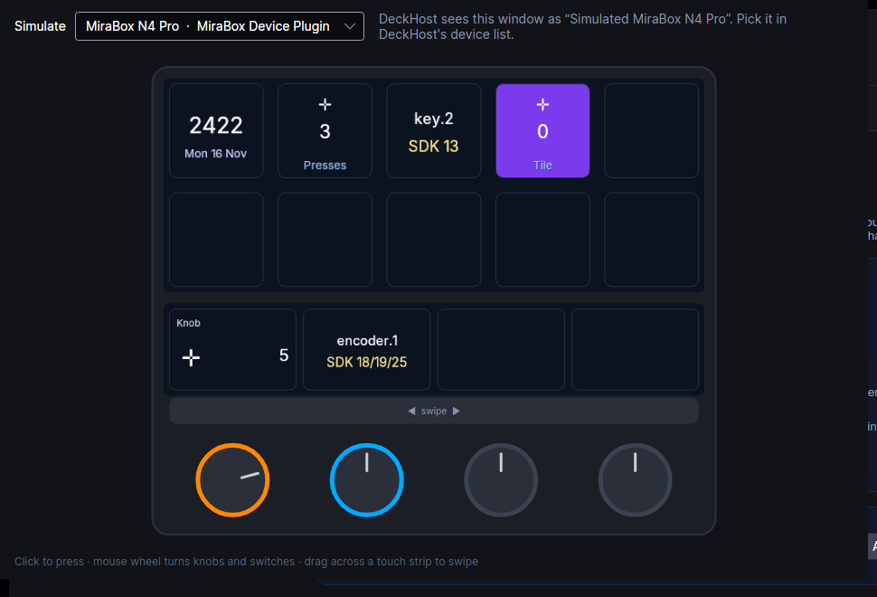

# Devices

DeckHost shows every device it knows in the device picker at the top. Each device has its own profiles. You can set a device up while it's unplugged; it picks up its profile as soon as it's connected.

## MiraBox / StreamDock

### N4 Pro

Ten keys, a touch strip with four zones and swipes, four knobs with LED rings. Everything works on Windows, Linux and macOS: keys, touch zones, knobs, lights, brightness, vibration, the boot video and the idle screen (**Device settings**).

- A knob without a display of its own shows its action on the touch zone above it. Turn this off per knob in its editor (**Show this on Touch …**).
- A swipe over the strip without an action of its own flips through the profile's pages.

### Other StreamDock models (preview)

DeckHost knows every model in MiraBox's SDK. Their layouts come from that SDK and haven't been tried on the hardware yet: if a key shows its picture in the wrong place or a knob turns the wrong way, please report it (**☰ → Help and support → Report a problem**).

| Model | What DeckHost uses |
|---|---|
| N4 | 10 keys, touch strip with 4 zones and swipes, 4 knobs (no LEDs) |
| 293 (V2, V3) | 15 keys |
| 293s | 15 keys and 3 small displays (pictures only) |
| M18 | 15 keys and 3 buttons |
| XL | 32 keys and a wheel on each side (turn and press) |
| M3 | 15 keys and 3 knobs |
| N3 | 6 keys, 3 buttons and 3 knobs |
| N1 | 15 keys, 3 small displays (two are buttons, one shows the knob) and a knob |
| K1 Pro | the keyboard's 6 display keys and 3 knobs |
| Mini | 6 keys and 2 side switches |

- **Side wheels** (XL) and **switches** (Mini) act like knobs: turn (or push left/right) to turn, push in to press.
- **Device settings** has the screen brightness and the idle screen for every model. The LEDs of the M18, XL and Mini aren't driven yet.
- A model you've plugged in once stays in the device picker, so you can set it up unplugged.

## Elgato Stream Deck (preview)

DeckHost talks to Stream Decks directly over USB, without Elgato's software. **Close the Stream Deck app first**: only one program can drive a deck.

| Model | Status |
|---|---|
| Stream Deck MK.2, Original v2 | supported |
| Stream Deck XL | supported |
| Stream Deck Neo | supported |
| Stream Deck + (dials and touch strip) | supported |
| Stream Deck Pedal | supported |
| First-edition Stream Deck, Stream Deck Mini | supported (older protocol, not tested on hardware yet) |

This support was written from the protocol and isn't tested on every model yet. Please report what works and what doesn't (**☰ → Help and support → Report a problem**).

## Devices you no longer use

DeckHost remembers every MiraBox and Stream Deck it has seen, so you can edit them unplugged (and
lists an N4 Pro before anything is plugged in). To remove one from the device picker, unplug it,
open **Device settings** for it and click **Forget this device**. Its profiles are kept: plug it in
again and it comes back with them. Devices from the device creator are removed on that page.

## Device simulator

Try DeckHost with any device it supports, without the hardware. It's a developer option: turn on
**DeckHost settings → Developer → Device simulator**, then **☰ → Device simulator** opens a window
that acts like the device you pick. DeckHost lists it as a connected device (**Simulated …**
in the device picker), sends it the same images and lights it sends the hardware, and takes its
input like the real thing.



- **Pick a model** at the top: every MiraBox model, every Stream Deck, the Web Deck and the devices
  you made in the device creator.
- **Click** a key, button or touch zone to press it (hold for a long press). The **mouse wheel**
  turns knobs and side switches. **Drag** across a touch strip to swipe.
- Knob rings show the **LED colors**, keys the **images**, the screen the profile's **background**.
  **Device settings** for the simulated device has its brightness, and vibration on models that
  vibrate (the window shakes).
- A simulated device has its **own profiles**. To try your real device's profile on it, use
  **Profiles → Copy to**.
- Open as many simulators as you like, each its own device. Closing one removes the device from the
  picker; its profiles are kept, and opening the same model again brings them back. It reconnects by
  itself when DeckHost restarts. Turning the setting off closes every simulator's connection.
- From a terminal: `DeckHost --simulator` (or `DeckHost --simulator deckhost.device.mirabox/mirabox.xl`
  for a model).

## Firmware

**Device settings → Firmware** shows the version each device runs. DeckHost installs firmware for devices whose plugin supports it, after you confirm: it checks the download, and the device doesn't respond until it's done. The N4 Pro, Stream Decks and other USB devices only show their version: MiraBox has no update protocol, Elgato's isn't public (use Elgato's app with DeckHost closed), and other devices use their maker's tool.

## Other USB devices (device creator)

Button boxes, foot pedals, jog wheels, game controllers and other USB devices DeckHost doesn't know can be made into a deck: **☰ → Add a USB device**.

1. **Pick the device.** The list shows every USB HID interface on the computer; a device can have several. Pick one and press a key: **What it sends** shows the device's reports. If nothing changes when you press, try the device's other interface.
2. **Add its keys and knobs.** Click **Add key** and press the key; DeckHost works out where it shows up in the reports. **Add knob**, turn it to the right a few clicks and click **Done turning**. For a knob you can push, select it and click **Learn push**. Pressing a key you already added says so. Keys light up on the canvas as you press them, and knobs show their turns.
3. **Place them** where they sit on the device: drag them, or **Arrange** them in rows. Keys are numbered by where they sit (left to right, top to bottom) and knobs left to right, so profiles copy cleanly between devices.
4. **Save device.** It joins the device picker with its own profiles, like any deck. **Edit** and **Remove** are on the same page.

What to know:

- These devices only send input. They have no screens or lights DeckHost could drive, so keys show their action's name on the canvas.
- **Windows keeps keyboards and mice to itself**: DeckHost can't read those interfaces. Many macro pads also have a vendor-defined interface (often listed as *vendor-defined*), which does work. A device that types keys will also keep typing them; DeckHost can't stop that.
- **Linux** needs a device rule, as for Stream Decks. The page shows the line and where to put it.
- **macOS** may ask to allow input monitoring for some devices.
- Descriptions are kept in `devices/hid/<name>.json`; they can be shared.

## Web Deck (phone, tablet or a window)

A deck in a web browser.

1. Choose **Web Deck** in the device picker.
2. Open **Device settings** and choose **This computer only** (a deck in a browser window here) or **Phones and tablets on this network**.
3. Set the number of columns and rows.
4. On the phone, open the address shown there (like `http://192.168.1.20:8765`) and enter the **pairing code** (like `K7QM-3XRD`; case and dashes don't matter). The phone remembers it unless you untick **Remember on this device**.

- **New pairing code** makes another code and disconnects every phone; they have to enter the new one. The link shown with the code in it skips typing, for a QR code or a message to yourself.
- **PIN (optional)** is asked once on each phone next to the code. Use it when others could see the code (a shared link, a screenshot). Changing it disconnects every phone too.
- After five wrong codes or PINs in a minute a phone has to wait a minute.
- On a phone, **Add to Home Screen** makes it a full-screen app. **Forget this device** (top right) removes the remembered code.

Allow DeckHost through your firewall when the system asks, or phones can't reach it.

### HTTPS and installing the deck as an app

Switch on **Use HTTPS (encrypted)** in the Web Deck's settings to serve the page and the deck over TLS, so the pairing code and what you press can't be read on the network. DeckHost makes a certificate for this computer (its name and network addresses) the first time and keeps it next to the deck's settings; it makes a new one when your network address changes or the old one is about to expire.

- The certificate isn't signed by anyone, so a phone or browser warns the first time. The fingerprint shown next to the setting is what to compare with the one the warning page shows before you continue.
- Browsers only offer to **install the deck as an app** (a full-screen icon of its own that opens the deck directly) over HTTPS or on this computer. DeckHost serves the app manifest, its icon and a small service worker for it; the worker only keeps the page itself and never the deck or the pairing. Chrome and Edge accept an app from a certificate you have clicked through only on some systems; Safari on an iPhone only does it once the certificate is installed and trusted in the phone's settings. Where the install button doesn't show up, **Add to Home Screen** still works.
- Plain HTTP stays the default, and a page at an `http://` address of the network can't be installed (that is the browsers' rule, not a DeckHost limit).

## Linux: the device rule

Linux only lets programs open USB devices they're allowed to. `install.sh` installs a udev rule (`70-deckhost-mirabox.rules`) for the N4 Pro and Elgato devices; unplug the device and plug it in again afterwards. Without it, DeckHost lists the device as not connected.

### Linux: AppImage

The `.AppImage` is the same DeckHost in one file: `chmod +x DeckHost-*.AppImage`, then run it. It needs FUSE 2 (`libfuse2`; on a system without it, run it as `APPIMAGE_EXTRACT_AND_RUN=1 ./DeckHost-*.AppImage`). It can't install the device rule itself, which needs root, so take the rule out of the file once:

```bash
./DeckHost-*.AppImage --appimage-extract usr/share/doc/deckhost/70-deckhost-mirabox.rules
sudo install -m 0644 squashfs-root/usr/share/doc/deckhost/70-deckhost-mirabox.rules /etc/udev/rules.d/
```

then unplug the device and plug it in again. DeckHost doesn't update an AppImage by itself (the file is a read-only image): the update screen offers the new `.AppImage` to download, and you replace the old file. **Start with the system** writes an entry that starts the file you ran.

## Checking the device support

Run DeckHost with `--check-native`. It loads the N4 Pro's native support, lists the devices it finds and exits, without opening a window.
