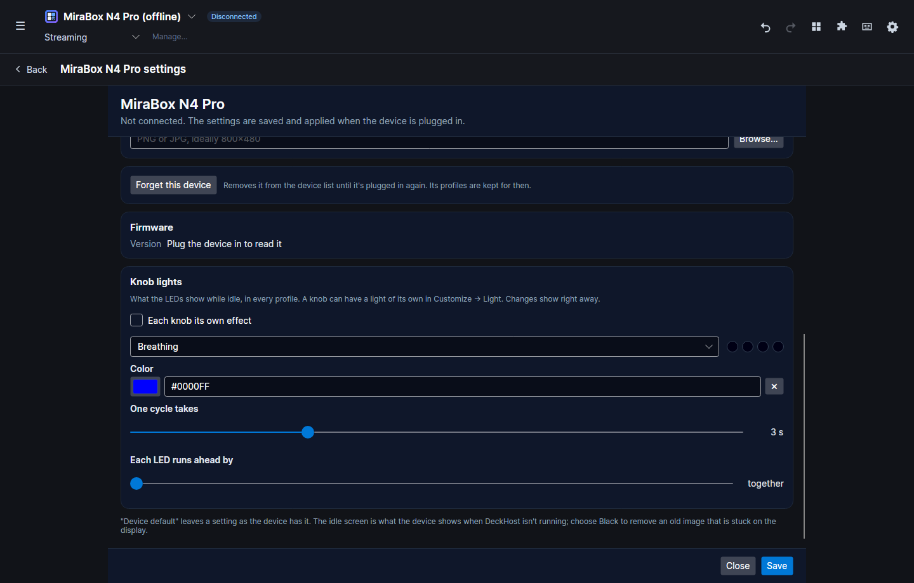

# Lights

Controls with an LED (the N4 Pro's knobs) have an idle light and a light when pressed.

- **Device settings → Knob lights** sets the light for all knobs: a color and an effect (solid, breathe, pulse, blink, color cycle, rainbow, wave, chase, candle, sparkle, a custom sequence, or off), how fast it goes, and how far each LED runs ahead of the previous one. **Each knob its own effect** gives every LED its own.
- A knob's own editor can override it (**Light**).

The canvas shows each knob's ring in its current color, also while the device is unplugged.
