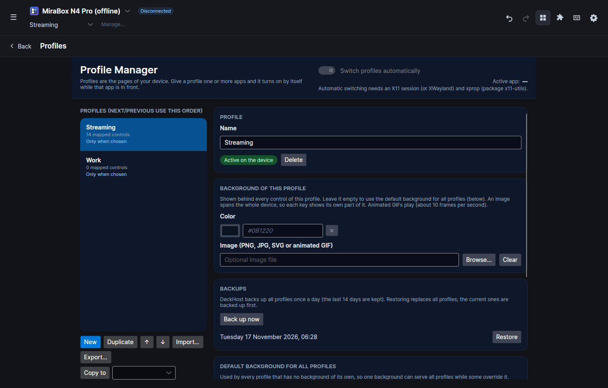

# Profiles, pages and folders

- A **profile** is what the whole device shows. Each device has its own profiles. Create, duplicate, rename, reorder and delete them on the **Profiles** page (the grid icon at the top right).
- A profile has **pages**: the page bar under the device adds and removes them. Swipe the touch strip, or use a **Page** action, to flip through them.
- A **folder** is a key that opens a set of keys, with a Back key in the first place. Drop the **Folder** action on a key, then double-click it (or **Open folder**) to fill it.

## Switching by app

Give a profile one or more apps (Profiles page): it turns on by itself while one of them is in front, and DeckHost goes back to the profile you chose by hand when you leave it. Turn this off in the **☰** menu. On Linux this works for X11 and XWayland apps and needs `xprop`.

An entry can be more than a name:

| Entry | Switches when |
|---|---|
| `obs64` | OBS is in front |
| `steam_app_*` | any app whose name starts with `steam_app_` (`*` is any text, `?` one character) |
| `chrome \| *YouTube*` | Chrome is in front with a window title that contains YouTube |
| `* \| *Zoom Meeting*` | any app shows a window titled with Zoom Meeting |

An entry with a window title wins over one without, and an exact name over a pattern, so a YouTube profile and a Chrome profile can live side by side. Window titles are read on Windows and on Linux (X11); on macOS only app names are used. The focused window's title is also the variable `system.foregroundTitle` for workflows.

## Backgrounds

A profile can have a background color and an image or animated GIF that spans all keys, with gradient, image and solid **layers** on top that can even follow the CPU load or a variable ([Backgrounds](backgrounds.md)). **Default background for all profiles** applies to every profile without one of its own.

## Another device

**Profiles → Copy to** (shown when DeckHost knows more than one device) makes a copy of the selected profile, with its pages and folders, for another device. Keys keep their row and column where the other device has them; keys that don't fit go, in order, onto pages added to the copy; dials and touch zones the other device lacks are left out. Importing a profile made for another device places it the same way.

## Export, import and backups

- **Export…** saves a profile with its pages, folders and images as a `.deckhostprofile` file. **Import…** adds one as a new profile.
- **Import…** also takes `.streamDeckProfile` files from the Elgato app. Pages, folders, Multi Actions and Multi Action Switches come along; actions of plugins you haven't installed are kept and work once you install them. The Profiles page lists those plugins with **Install**; on the device such a key has a yellow **!**, and selecting it offers **Install**, **Turn it on** (for a plugin that's off) or **Remove**. Dropping another action on it replaces it.
- DeckHost keeps a copy of your profiles from each of the last days; **Backups** on the Profiles page lists them: **Restore** brings one back, **Back up now** makes one.
