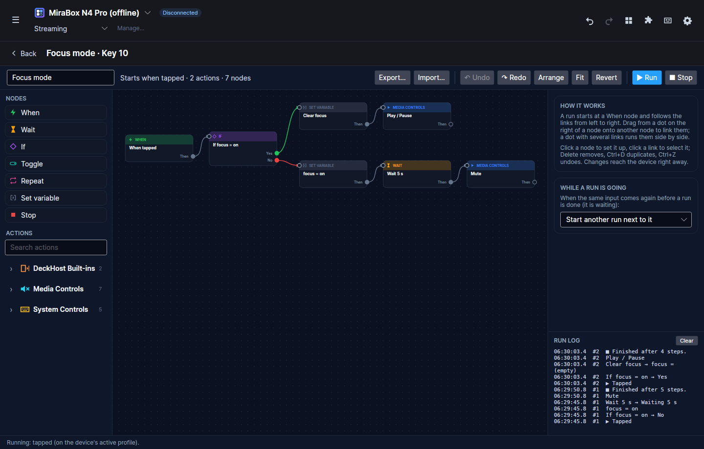

# Workflows

A workflow is what a control does, drawn as nodes linked on a canvas. Drop the **Workflow** action on a control (or use **Turn into a workflow…** in its editor), then **Open workflow editor**.

## How a run goes

A run starts at a **When** node and follows the links from left to right. A node's dots on the right are its outputs; drag from one onto another node to link them. An output with several links runs them side by side, and the run ends when every branch is done.

## Nodes

| Node | What it does |
|---|---|
| **When** | Starts the workflow: the control is pressed, released, tapped, double pressed, held down, turned left or right, or swiped left or right, or something happens that has nothing to do with the control (see [Workflows that start by themselves](#workflows-that-start-by-themselves)). A workflow can have several. |
| **Action** | Runs an action, with its own settings. Drop an action from the list on the left onto the canvas. If the action did not run (its plugin isn't loaded, or it failed), the run goes on at **On error** when that has a link, else at **Then**; the node can also try again first (see [When an action fails](#when-an-action-fails)). |
| **Wait** | Waits, then continues. The device keeps working. While a run waits the node fills up over the time it takes. |
| **If** | Continues at **Yes** or **No**: a variable (equal to, greater than, containing, empty, …), the app in front (part of its name), or the time of day (also past midnight, 22:00–06:00). |
| **Toggle** | Takes **1st** and **2nd** in turn: on, then off. |
| **Repeat** | Runs **Each time** one round after the other, then **Done**. How many rounds: a fixed number, as many as a variable says, **while** a variable has a value, or **until** it does. An optional pause between rounds turns it into a timer (a condition that never changes stops after 10,000 rounds). |
| **Set variable** | Sets, adds to, subtracts from, flips (true/false) or clears a variable. |
| **Stop** | Ends the run, including branches that are still waiting. |

Variables are shared by all workflows (names ignore case). The **Show Variable** action shows one on a key. They start empty when DeckHost starts.

## Workflows that start by themselves

A When node can also start on an event, so a workflow can react without anyone pressing the control:

| Starts when | Settings |
|---|---|
| **The profile comes onto the device** | Also when DeckHost starts. |
| **An app comes to the front** | Part of the app's name (`obs` matches `obs64.exe`). Needs DeckHost to see the app in front: Windows, macOS, Linux on X11. |
| **A variable changes** | The variable's name, and optionally the value it has to change to. Variables set by a Set variable node, another workflow or the **Show Variable** action count. A value that is set again without changing doesn't start it. |
| **Every so many seconds** | From 1 second to a day, counted from when the profile was shown. |

Event triggers run on a workflow whose profile (page or folder) is shown on a device; put the workflow on a control that isn't used for anything else. An event never piles runs up: it waits until the workflow's previous run is done. A workflow that keeps starting itself, such as one that changes the variable it starts on, is paused for half a minute after 20 starts within 5 seconds, and the log says so.

## When an action fails

An action node has two outputs: **Then** and **On error**. When its action did not run, the run follows **On error** if you linked it, so a failing step can show a warning, run something else or end the run; with nothing linked there, it goes on at **Then** as before. In the node's settings, **Try again when it did not run** (up to 5 times) and **Wait between tries** make the node try again first, and the node fills up while it waits for the next try. New actions you add after a node are linked from **Then**; link **On error** yourself by dragging from its dot.

## While a run is going

When the same input comes again before its run is done (a wait), the workflow can **start another run** next to it (the default), **ignore** the input, **stop the run and start again**, or **stop the run**, which makes the key a stop button.

## The editor

- Click a node to set it up on the right; click a link to select it. **Delete** removes, **Ctrl+D** duplicates, **Ctrl+Z / Ctrl+Y** undo and redo. Right-click a node for Duplicate, Take off its links and Remove, a link for Remove link, or the background for Fit, Arrange and Undo.
- Drop a node onto a link, from the lists or by dragging one that isn't linked yet, and the link opens up and the node goes in between (one undo step). Stop and When nodes can't go into a link.
- The actions on the left are grouped by plugin like in the main window; the search opens every group with a match.
- **Arrange** lays the nodes out from left to right; **Fit** shows them all. Drag the background to pan, and use Ctrl + the mouse wheel to zoom.
- **Run** starts the workflow as if the control was used; **Stop** stops every run. Each step lights up on the canvas and appears in the run log.
- Links can't form a loop (use Repeat) and can't lead into a When node.
- Every change reaches the device right away; **Revert** puts back the workflow as it was when you opened the editor.

## Name and share a workflow

Give a workflow a name in the box above the canvas; it shows in the editor's title. **Export…** saves it as a `.deckhostworkflow` file and **Import…** replaces the workflow you have open with one from a file (Undo brings yours back). The file holds the nodes, their settings and the links, and DeckHost checks it before using it: unknown nodes, links that lead nowhere or form a loop, and oversized files are refused. An action node needs its plugin installed on the machine that imports it; without it the node stays and is skipped when the workflow runs.
